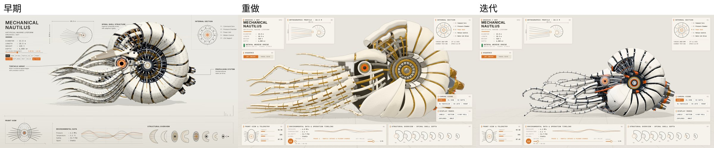
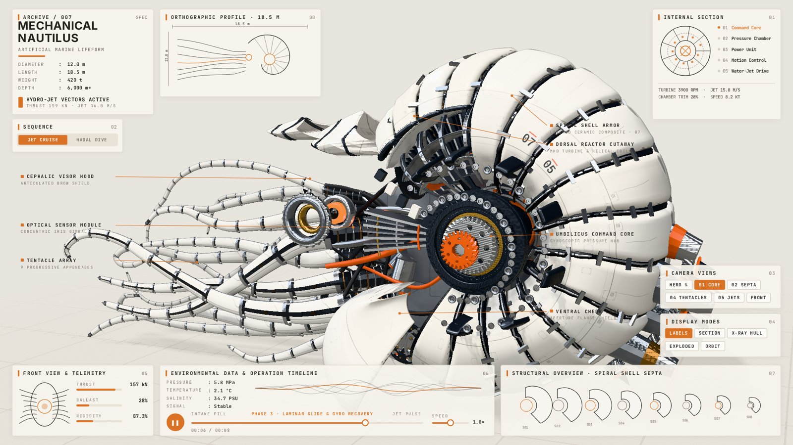
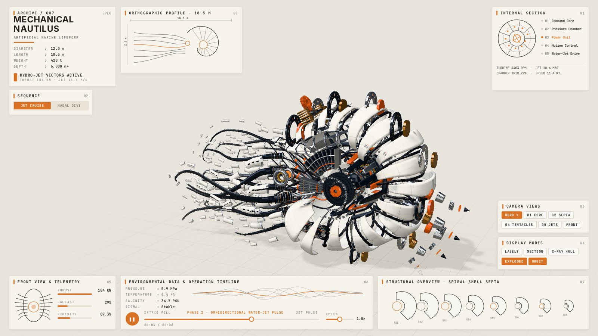
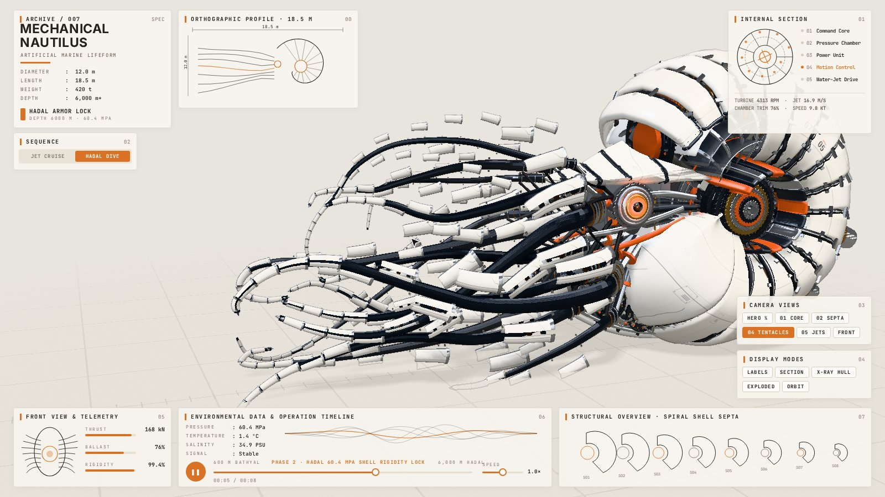
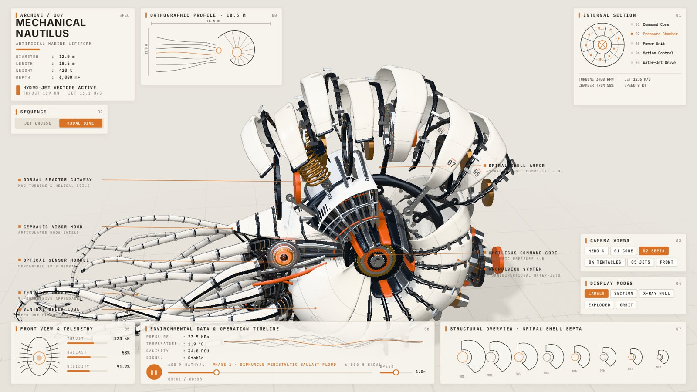

# 机械鹦鹉螺 · calibration-lab 的来历

calibration-lab 的机器感原语与关卡（`kernel.js` §8、`tools/lookcheck.py --gates`）是从这只鹦鹉螺上长出来的。
它由作者用 Gemini 在 `teardown` 工作台（MIT，见 `CREDITS.md` §D）里逐版迭代完成，每一版的改动与原因都有记录；
做完之后，把其中通用的部分搬进了本风格。

## 怎么走过来的

- **早期**：让 Gemini 直接照原项目做。机器感有了，外形不对，不满意。
- **重做**：推倒重来，外壳改在 Blender 里建模，按参考图对剪影。从这时起，整体已经接近参考。
- **迭代**：之后一直在抠细节：机器感、主光与釉面、触手走向、细节随相机距离出现。回头看有些地方改得过头了，效果差别不大，时间花得不少。这也是我们把"看起来对不对"做成能出数字的关卡的原因：知道什么时候该停。

| 核心 | 拆解 |
| :-: | :-: |
|  |  |
| **触手** | **隔板** |
|  |  |

## 源码

最终版已移植为本风格的默认样片：`../../world.js` + `../../sample/`（模型、运动学、配色、teardown kit 兼容层、Blender 外壳 `hull.glb`）。
新的机械题材请用内核写，不要以样片为模板（ADR-013 / `SPEC.md` 零复用规则）。参考概念图不随仓库分发。
